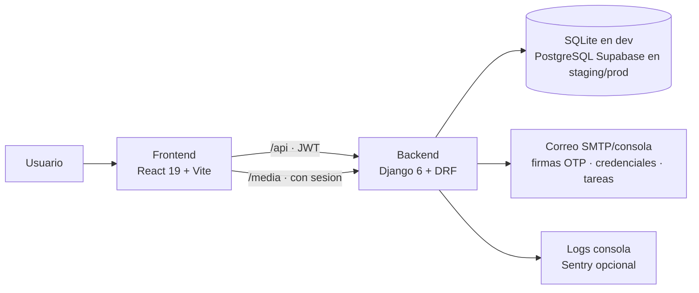
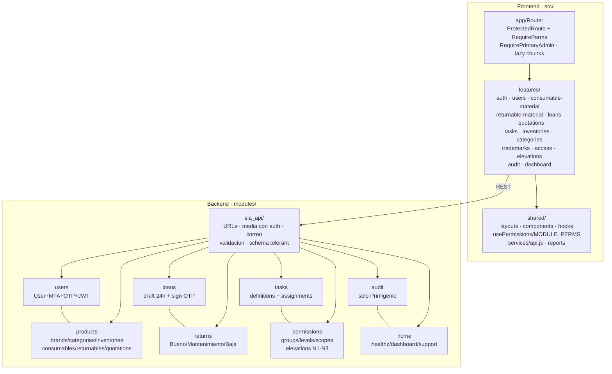
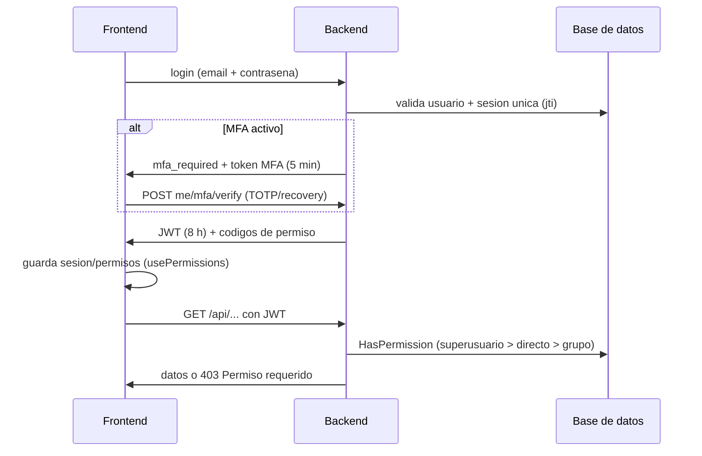
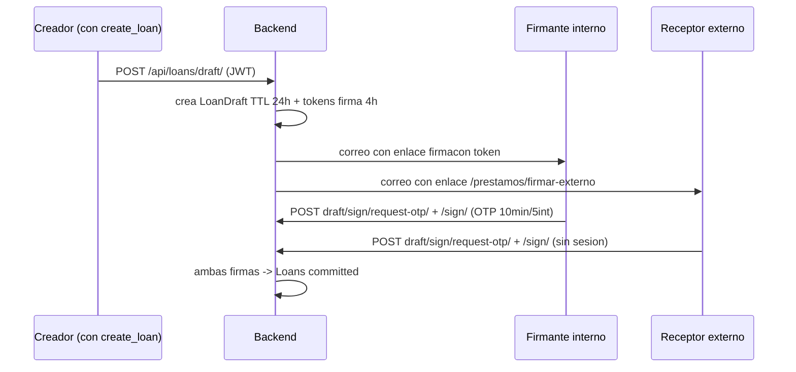

# Arquitectura de SAGI

Visión general del sistema: dos aplicaciones (frontend + API) sobre una sola base de datos por entorno (`docs/entornos.md`).

## Diagrama general

- En desarrollo, Vite redirige `/api` y `/media` al backend (`127.0.0.1:8000`); el frontend no necesita `.env` (`frontend/vite.config.js`).
- Los archivos (`/media`: fotos, fichas, cotizaciones, evidencias) solo se sirven con sesión (`AuthenticatedMediaView`, Ley 1581 de 2012). En prod el servidor web debe redirigir `/media/*` a Django.
- Estáticos de prod vía WhiteNoise (`STATIC_ROOT`); `CONN_MAX_AGE=0` con PgBouncer pooler `6543`; directa `5432` para `migrate`/`pg_dump`.

## Módulos

Detalle de contratos: [`endpoints.md`](endpoints.md) (API), [`roles-permisos.md`](roles-permisos.md) (autorización), [`matriz-pruebas.md`](matriz-pruebas.md) (trazabilidad a pruebas).

## Autenticación y permisos

Reglas clave:

- **Superusuario** > **permiso directo** > **permiso por grupo** (`PermissionService`, caché 300 s).
- Niveles `SADMIN 100 / ADMIN 200 / INST 300 / INV 400` (menor = más poder), techos y `is_system`; alcance `SELF/ALL` solo en permisos con objeto.
- Los permisos se administran en la UI (Roles y permisos) y se exigen en el backend con `HasPermission("<codename>")`; el frontend los refleja con `MODULE_PERMS` (nunca nombres de grupo hardcodeados).
- Las migraciones crean los permisos y los grupos base; las `0004–0024` agregan los codenames vigentes y el backfill de alcance.
- Auditoría: escritura por `AuditMixin`/login/logout/firmas; lectura `GET /api/audit/` solo `is_primary_admin`.
- Filtros globales: `DjangoFilterBackend + SearchFilter + OrderingFilter`.

## Capturas de pantalla

Las imágenes de la interfaz viven en [`capturas/`](capturas/) (ver su `README` para la convención de nombres y módulos a cubrir).

---

← [Volver al README](../README.md) · [Instalación local](instalacion-local.md) · [Referencia API](endpoints.md) · [Roles y permisos](roles-permisos.md)
